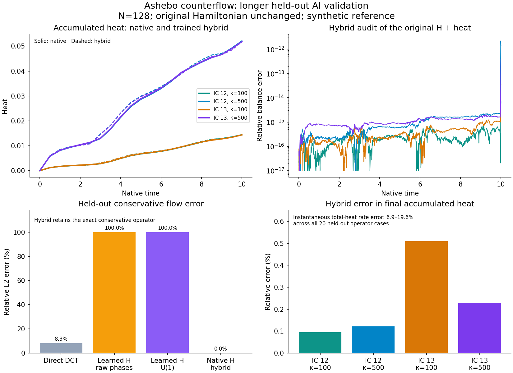

# Ashebo CounterflowBench — physics AI benchmark

**Yohannes Beyene Ashebo · Ashebophysics · AI component v0.1.0 · Apache-2.0**

A runnable synthetic benchmark for learning coupled conservative dynamics and nonlinear heat production. It provides **50 labeled radial trajectories, fixed initial-state splits, an evaluated PyTorch heating surrogate, and audits against the original Hamiltonian**. Researchers can plug in their own neural models and score predictions in a common format.

For a lightweight library for **your own Hamiltonian**, use the separately installable [Ashebo Hybrid framework](framework/README.md): `pip install ./ai_benchmark/framework`. It has no dependency on this dataset or the RGT source. CounterflowBench is its larger reference application.

Installing both also enables `ashebo_counterflowbench.engine_bridge.create_system`, which maps the exact native Hamiltonian and frozen mobility model into the standalone framework's canonical contract.

The component lives entirely in `ai_benchmark/`. Installation, model inference and tests do not change the original solver, its equations, dependencies or archived v0.1.0. All 94 pre-existing repository files are protected by a checksum manifest. Optional native evaluation compiles kernels in a temporary copy.

## Start in two minutes

From a clone of this repository, create an isolated environment and install the NumPy interface:

```bash
python -m venv ai_benchmark/.venv
source ai_benchmark/.venv/bin/activate
python -m pip install ./ai_benchmark
counterflowbench info
counterflowbench verify --solver .
counterflowbench demo
```

On Windows, activate `ai_benchmark\.venv\Scripts\activate` instead. The optional native C workflow below was tested on Linux.

The first demo is a transparent NumPy training-mean mobility baseline. For the **trained neural model**, add the optional PyTorch dependency:

```bash
python -m pip install './ai_benchmark[torch]'
counterflowbench demo --pretrained --case seed12_k100
```

The frozen hybrid retains the native conservative flow and receives the exact Hamiltonian phase torque. It learns the positive dissipative mobility. It does not replace the entire Hamiltonian. No C compiler or native integration is needed for these demos: the exact conservative and torque labels are included in the dataset.

The verified environment was Python 3.12.14, NumPy 2.3.5, SciPy 1.17.0 and PyTorch 2.15.0+cpu. PyTorch, SciPy and Matplotlib are optional; the base data loader and operator grader use NumPy only. No PyPI release is implied by this source install.

## Choose a research task

| Task | Inputs | Prediction target | Evaluation |
|---|---|---|---|
| Known-H dissipative response | Eight fields, κ, exact native conservative flow and phase torque | Unit-κ phase relaxation and heat power | Rate/heat errors, nonnegative heat, native power closure |
| Full-flow learned dynamics | Eight fields, radial grid, κ | Full time derivative and heat power | Prediction error, native energy power residual, global and local reference content balance |
| Free rollout | A held-out initial state, grid, κ | Predicted trajectory and accumulated per-cell heat | Native H evaluated on predicted states, total-content drift, accumulated heat error and completion |

The first task is the validated pretrained example. Full-flow replacements are a harder challenge: the three tested candidates did not pass the longer rollout checks. Their scores and training recipes are included so a new model can be compared honestly. The separate tasks use different amounts of exact physical information and should be reported separately.

This is supervised learning from labeled discrete operators. It is not a claim that the complete Hamiltonian can be uniquely recovered from trajectories alone.

## Load data in your own code

```python
from ashebo_counterflowbench import load_case, load_split, grade_operator

training_cases = load_split("train")
case = load_case("seed12_k100")
print(case.state_y.shape)       # (21, 128, 8): time, radial cell, field
print(case.rhs_y.shape)         # (21, 128, 8): log-chart total derivative
print(case.heat_power.shape)    # (21, 128): per-cell heat power

# Replace these reference arrays with your own model predictions.
scores = grade_operator(case, rhs_y=case.rhs_y, heat_cells=case.heat_power)
```

For a channel-first PyTorch pipeline:

```python
from torch.utils.data import DataLoader
from ashebo_counterflowbench.torch_data import OperatorDataset, WindowDataset

batch = next(iter(DataLoader(OperatorDataset("train"), batch_size=8)))
print(batch["state_y"].shape)       # (8, 8, 128), float64
print(batch["grad_H_x"].shape)      # (8, 8, 128), canonical gradient
windows = WindowDataset("test", frames=11)
print(windows[0]["state_y"].shape)  # (11, 8, 128)
```

All κ variants of an initial-state seed remain in one split. Windows stay within one trajectory. No normalizers are silently fitted to test data. `examples/train_pytorch.py` demonstrates validation-only checkpoint selection using a small, unconstrained baseline; passing that example does not certify its prediction quality.

## Submit predictions to the grader

Save an operator prediction as an NPZ containing `rhs_y` with shape `(21,128,8)` and `heat_cells` with shape `(21,128)`. The latter is **per-cell heat power**, already including κ, not heat density or accumulated heat. Optional `time` must match the case exactly.

```bash
counterflowbench evaluate my_operator_prediction.npz --case seed12_k100 --output scores.json
counterflowbench export --split train --output my_training_data
```

For a free rollout, save `state_y` and accumulated per-cell `heat_cells` with the same time/grid layouts, and start its heat ledger at zero. The grader recomputes the original H on each **predicted** state:

```bash
python -m pip install './ai_benchmark[native]'
counterflowbench evaluate my_rollout.npz --rollout --case seed12_k100 --solver .
```

Use a C compiler named `cc`; native evaluation was tested on Linux. Do not substitute reference H values for H evaluated on predicted states. Numerical identities of a learned H alone do not certify accuracy against the native H. NaN/Inf predictions are rejected as failed predictions. Unknown output files are not overwritten automatically.

## Generate a new reference without changing the solver

```bash
counterflowbench generate --solver . --seed 16 --kappa 100 --stop 10 --frames 21 --output new_reference.npz
```

The helper compiles a temporary source copy, uses the same preparation coefficients and native equations, and writes only the requested output. The library interface also supports energy, gradients and conservative/full RHS evaluation:

```python
from ashebo_counterflowbench import load_case
from ashebo_counterflowbench.native import NativeHamiltonian

case = load_case("seed12_k100")
with NativeHamiltonian(".") as native:
    labels = native.evaluate(case.state_y[0], kappa=100)
    H = native.energy(case.state_y[0])
```

To run a complete **prediction** with the pretrained heating model coupled to the native Hamiltonian:

```bash
python -m pip install './ai_benchmark[torch,native]'
counterflowbench rollout --solver . --case seed12_k100 --output predicted_rollout.npz
```

This advances the predicted state freely from its starting condition, then grades H on that predicted trajectory. It uses no future reference states during integration. The native C component is used for inference and is not an end-to-end differentiable neural integrator.

One native context per process is supported. Source hashes are checked before native loading. A different grid, initial-state family or horizon needs its own numerical qualification; the shipped checkpoint is fixed at 128 cells.

## What was tested

The benchmark has 1,024 evolving mechanical variables at 128 radial cells and 21 snapshots over native time 0–10. There are 24 training, 6 validation and 20 test trajectories, with **8 / 2 / 4 distinct initial-state seed groups**. They belong to one manufactured-profile neighborhood.

| Recorded check | Result |
|---|---:|
| Native reference trajectories completed | 50 / 50 |
| Worst relative native H + accumulated heat error across accepted reference steps | 3.47 × 10⁻¹⁵ |
| Worst relative native total-content error | 1.68 × 10⁻¹⁵ |
| Pretrained hybrid long rollouts completed | 4 / 4 planned cases |
| Final accumulated-heat error on those four cases | 0.095%–0.51% |
| Instantaneous total-heat-rate relative L2 error across 20 held-out operator cases | 6.9%–19.6% |
| Hybrid saved-state difference under a time-step-halving control | 2.34 × 10⁻⁹, scaled max |

Small accumulated-heat errors do not imply equally small instantaneous errors. Only four planned test cases received free hybrid long rollouts. The complete records, including failed full-flow models, are in the package's `resources/evidence/`; `research/long_horizon/` contains the full reproduction scripts. The historical records' `public_upload: false` flags describe the original local run, before this GitHub packaging.



## Coordinate and scientific scope

- Dataset state order is `(log N_C, log N_R, theta_C, theta_R, alpha, beta, P_alpha, P_beta)`. The first two stored coordinates are logarithms, **not canonical contents**. `case.state_x` converts them to extensive canonical contents.
- Canonical pairs have q indices `(0,1,4,5)` and p indices `(2,3,6,7)`. `grad_H_x` is a canonical extensive gradient. See [SCHEMA.json](SCHEMA.json).
- Global `sum(N_C+N_R)` is conserved. Local cells exchange and transport content; their individual contents are not constant.
- Mechanical H decreases through dissipation. H plus accumulated heat is conserved. The original five ledgers contain an overlapping fifth diagnostic: total native heat is the sum of the **first four** only.
- These are fixed-grid synthetic solutions of a proposed radial model, in native units. They are not experimental ground truth, a calibrated physical entropy model, a demonstrated general 3D/SU(3) theory, or established spatial continuum solutions. The original solver's documented limitations remain applicable.

## Reproduce the scientific experiment

```bash
python -m pip install './ai_benchmark[research]'
python ai_benchmark/research/long_horizon/reproduce.py --release . --output /tmp/counterflow_reproduction
```

The output directory must be new. The scientific driver checks the unchanged native sources and allows only the three already-known citation/manifest metadata differences from the original frozen release. It generates the 50 references, trains three full-flow candidates, evaluates their rollouts, trains/evaluates the known-H hybrid, and runs adaptive diagnostics. Exact results depend on runtime versions and hardware. The original run used one neural seed per new architecture; no statistical superiority over all models is claimed.

Tests for this public interface:

```bash
python -m unittest discover -s ai_benchmark/tests -v
```

## License and citation

Code and project-owned data: **Apache-2.0**, including commercial use under its terms. See [LICENSE](LICENSE), [NOTICE](NOTICE), and the parent project's notices. Citation is requested for scholarly attribution; no additional license restriction is imposed.

Use [CITATION.cff](CITATION.cff) for this AI component. Cite the original solver separately when using its equations: [Ashebo RGT Hamiltonian v0.1.0, DOI 10.5281/zenodo.24407743](https://doi.org/10.5281/zenodo.24407743). That existing archive predates this AI component and does not archive these new benchmark files. No separate benchmark DOI is claimed.

Research led by Yohannes Beyene Ashebo; implementation and audits developed with ChatGPT assistance. The reported checks are internal computational validation. External replication is welcome.
