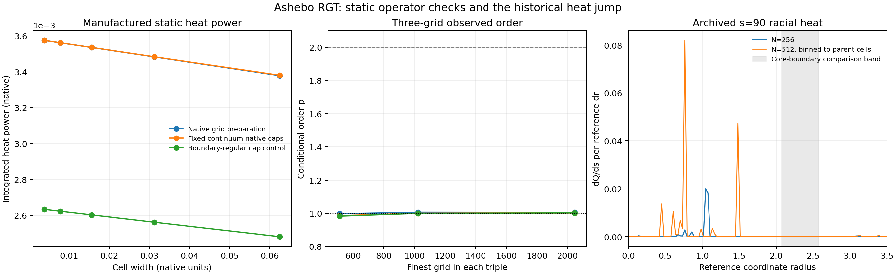

# Zero-integration static scaling and saved-state radial diagnosis

Yohannes Beyene Ashebo · Ashebophysics · November 20, 2026

The requested operator check is implemented in `static_scaling.py`. Its public `evaluate_audit_operators` hook returns the six requested quantities. No ODE trajectory is integrated. Manufactured 1024/2048 profiles are not represented as evolved s=90 states. No factor of cell width has been added to kappa.

## Fixed-parameter smooth-profile result

The principal controlled family freezes active exchange strength at 0.04080087121508541, kappa=100, j0=4.60963676251496e-16, p0, and continuous speed-cap functions. It evaluates the user-supplied intensive density and phase profiles with zero metric strain/momentum. The cap functions are the analytic continuum limit of the native launch preparation, sampled on each grid. This is an explicit static input choice, not an empirical parameter fit.

| Cells | Heat power | max paired current per area | max phase-torque density |
| ---: | ---: | ---: | ---: |
| 128 | 0.003381064940 | 0.004973795 | 0.064903469 |
| 256 | 0.003484024711 | 0.0050774925 | 0.068999667 |
| 512 | 0.003536012746 | 0.0051486832 | 0.070979171 |
| 1024 | 0.003562002027 | 0.0051842582 | 0.071935733 |
| 2048 | 0.003574975982 | 0.0051985339 | 0.072403579 |

| Triple | Observed p | Conditional extrapolated heat |
| --- | ---: | ---: |
| 128, 256, 512 | 0.985829 | 0.003589037345 |
| 256, 512, 1024 | 1.000263 | 0.003587981837 |
| 512, 1024, 2048 | 1.002298 | 0.003587908697 |

The measured differences contract at approximately first order. The final doubling exponent alpha=log2(Q_2048/Q_1024) is about 0.00525, approaching zero. These results support finite integrated heat for this smooth test family and give no evidence of an unavoidable N or N^2 divergence in this observable. They do not establish a universal continuum theorem, second-order accuracy, or a physical explanation of the historical heat jump.

First-order behavior is compatible with the one-sided donor-density choice in the directional energy: sampling a donor at r_face +/- h/2 generally has an O(h) term relative to the face value. This is a consistency explanation, not a proof that this term alone sets every observed error. There is no basis here for forcing convergence by multiplying kappa by h or h^2.

## Additional preparation controls

The original per-grid cap preparation and a separate boundary-regular manufactured cap field are also tested on all five grids. Both show integrated-heat order near one. The latter cap field is a declared parameter-field control with no internal cutoff, not a modification of the archived model or saved states.

The pointwise phase-torque density deserves care: the native per-grid preparation grows from max|D/V| about 0.0645 at 128 cells to 1.077 at 2048, with the finest maximum near reference radius 7.71. The fixed-continuum native-cap family instead stays bounded near 0.0724, with its maximum near the origin. Thus integral convergence does not establish uniform convergence of all native-preparation derivatives. Preparation of the cap field outside the nominal r=4 taper is a separate issue to examine.

## What the cell-measure check actually says

The code uses j_bar as an average of complete paired face currents **per proper area**, not shell-integrated current. Raw Hamiltonian phase derivatives are cell-integrated. For uniformly smooth intensive fields, D_i=O(V_i) and N_Ci+N_Ri=O(V_i), giving cell power kappa*j_bar_i*D_i^2/(N_Ci+N_Ri)=O(V_i) when j_bar is bounded. This is a volume-weighted sum without an automatically missing h factor. At fixed positive radius V_i=O(h); the first origin cell instead has V_0=O(h^3), and radial regularity must be handled consistently.

The supplied theta_C profile has derivative about 3.20e-5 at r=8, so it does not exactly satisfy the stated zero-derivative outer condition. More generally, zero phase gradient alone does not imply zero current for this logistic directional law. The cap field and wall flux prescription matter. The native canonical sign is N_dot=+H_theta/eta; the opposite phase equation carries the minus sign.

## Localization of the historical s=90 jump

Fine-grid powers are conservatively summed in pairs into their exact coarse parent shells. They are compared in the shared reference radial coordinate, not by aligning distinct areal-radius cells. The sum of shell differences reproduces the total heat-power difference.

| Reference-radius region | Power at 256 | Power at 512 | Share of net heat increase |
| --- | ---: | ---: | ---: |
| 0 to 1.75 | 0.001441557417 | 0.005436509242 | 99.793755% |
| 1.75 to 2.5 | 2.412268793e-07 | 1.080276286e-06 | 0.020959% |
| 2.5 to 3 | 2.992657626e-08 | 6.32674336e-06 | 0.157294% |
| 3 to 8 | 6.004333184e-05 | 6.116387893e-05 | 0.027991% |

| Parent-shell center | Delta power, fine minus coarse | Share of net heat increase |
| ---: | ---: | ---: |
| 0.765625 | +0.002471903863 | +61.7481% |
| 1.484375 | +0.001481259277 | +37.0018% |
| 1.046875 | -0.0006216046278 | -15.5277% |
| 1.078125 | -0.0005690022292 | -14.2137% |
| 0.453125 | +0.0004270872776 | +10.6686% |

Shares are signed contributions to the net increase; positive and negative shell differences can cancel. The dominant additional power is in the inner region r<1.75. The core equality boundary is near r=2.322 on both grids. A common band spanning both boundary +/-0.25 neighborhoods has a negligible negative contribution to the heat jump, rather than explaining its increase. This rules against assigning the observed jump primarily to that selected boundary band, but it does not identify a unique wave or transport mechanism.

Freezing the exchange strength at the common 512-cell value only for the readout of the same saved states leaves the ratio essentially unchanged (about 3.665479149). This is a local sensitivity check, not re-evolution with fixed historical coefficients. Effects of different preparation, prior dynamics, nonsmooth gate activation and temporal phase error remain separate questions.

## Reproduce

```sh
python3 static_scaling.py
python3 make_static_figures.py
```

Full rows, three-grid fits, per-cell arrays, region sums and the unchanged-state sensitivity check are in `results/static_scaling/`. The complete native source and all input snapshots remain unchanged.


